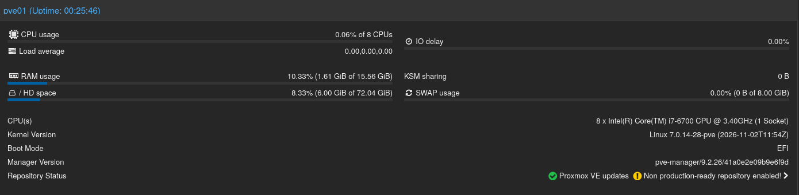
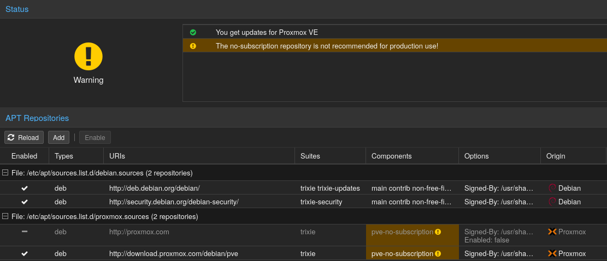
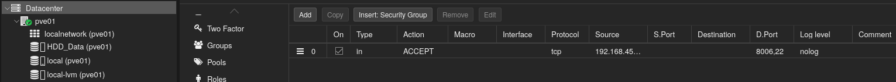
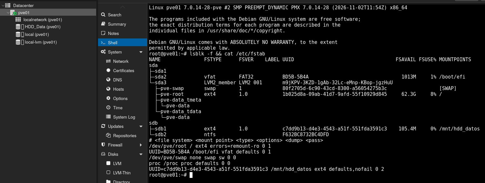
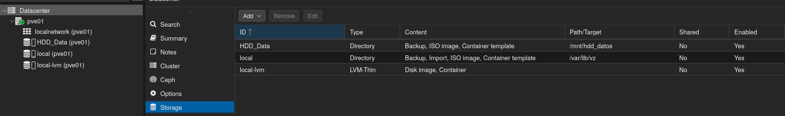
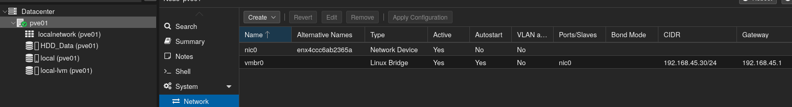

# Informe Técnico: Despliegue de Servidor de Virtualización Bare-Metal con Proxmox VE e Integración en Red Segura

## 📝 1. Introducción y Objetivos del Proyecto

El objetivo de este proyecto es dar el salto desde un equipo de escritorio tradicional hacia una arquitectura de servidor real, transformando la torre dedicada del laboratorio (previamente optimizada térmicamente en el **Proyecto 01**) en un **Hipervisor de Tipo 1 (Bare-Metal)** mediante **Proxmox Virtual Environment (Proxmox VE 9)**.

A nivel práctico y de aprendizaje, este laboratorio permite comprender cómo se abstrae el hardware físico para ejecutar múltiples sistemas operativos aislados a la vez, cómo funciona un switch virtual en Linux (`vmbr0`) y cómo aplicar buenas prácticas de administración de sistemas: respaldos previos, separación de almacenamiento por rendimiento y cortafuegos perimetral.

## 🛠 2. Ficha Técnica del Hardware (Inventario de Servidor) y Estado Inicial

La infraestructura física utilizada para el despliegue cuenta con las siguientes especificaciones:

* **Servidor Bare-Metal:** Torre dedicada con procesador Intel Core i7-6700 (4 núcleos / 8 hilos), 16 GB de memoria RAM DDR4 y placa base MSI B150 Gaming M3 (`BIOS AMI B.70`).
* **Almacenamiento Híbrido:**
  * **Unidad Principal (`/dev/sda`):** SSD Crucial MX300 de 256 GB destinado al sistema operativo del hipervisor y a los discos de ejecución de las máquinas virtuales.
  * **Unidad Secundaria (`/dev/sdb`):** HDD Western Digital Blue de 1 TB destinado al almacenamiento masivo de copias de seguridad, imágenes ISO y plantillas.
* **Conectividad de Red:** Interfaz Gigabit Ethernet (`nic0`) conectada mediante latiguillo Cat 6 U/UTP al **Nodo Satélite 3 TP-Link Deco M4R** (Modo AP) dentro del segmento seguro `192.168.45.0/24` (configurado en el **Proyecto 02**).
* **Medios de Arranque y Contingencia:** Unidades USB multiboot Ventoy (`VENTOY_PROD` de 128 GB y `VENTOY_BKUP` de 64 GB).
* **Estado Inicial:** El equipo operaba bajo Windows 10 nativo con las extensiones de virtualización por hardware (`Intel VT-x` / `VT-d`) deshabilitadas de fábrica en la BIOS.


## 🔄 3. Protocolo de Continuidad y Plan de Retorno (Rollback)

Antes de formatear el almacenamiento del equipo, se ejecutó un protocolo preventivo para asegurar la reversibilidad total del laboratorio:

1. **Extracción de Licencia OEM:** Desde PowerShell con privilegios de administrador en Windows 10, se recuperó la clave embebida en la placa base (ACPI/UEFI) y se guardó en la unidad de contingencia **`VENTOY_BKUP`** (`/Backup_Critico/oem_key_respaldo.txt`):
   ```powershell
   (Get-WmiObject -Query 'select * from SoftwareLicensingService').OA3xOriginalProductKey | Out-File -FilePath C:\Users\Public\Documents\oem_key_respaldo.txt
   ```
2. **Estrategia de Recuperación:** En caso de necesitar devolver el equipo a su estado original, se dispone de los medios USB Ventoy (`VENTOY_PROD` y `VENTOY_BKUP`) con la ISO oficial de Windows, pudiendo limpiar las particiones LVM de Linux mediante `diskpart` (`clean`) y reinstalar Windows manteniendo su activación digital.

## ⚙️ 4. Preparación de Hardware y BIOS (UEFI)

Para que el hipervisor pueda crear máquinas virtuales con rendimiento cercano al nativo, fue necesario habilitar las extensiones de virtualización en el firmware de la placa base **MSI B150 Gaming M3** (`BIOS AMI B.70`):

* **Intel Virtualization Technology (`VT-x`):** Activado (`Enabled`). Permite al kernel KVM de Proxmox ejecutar instrucciones de virtualización directamente sobre el procesador.
* **Intel `VT-d`:** Activado (`Enabled`). Habilita la virtualización de entrada/salida (IOMMU) para aislar interrupciones y permitir en el futuro asignar hardware PCIe directo a una máquina virtual.
* **SATA Mode:** Configurado en `AHCI` para aprovechar el rendimiento nativo del SSD Crucial.
* **Boot Mode:** Configurado en `UEFI`.

## 💿 5. Instalación del Hipervisor mediante Entorno Dual Ventoy

Para el despliegue se utilizó la estrategia de almacenamiento extraíble configurada previamente:
* **`VENTOY_PROD` (Samsung BAR Plus 128 GB):** Unidad principal con el catálogo de ISOs y la carpeta `/Toolkit_Soporte` oculta del menú de arranque mediante `.ventoyignore`.
* **`VENTOY_BKUP` (Kingston DataTraveler SE9 Gen 3 64 GB):** Unidad de respaldo con ISOs críticas y documentación de red (`topologia_192.168.45.0.txt`).

### Puntos Clave de la Instalación
1. **Arranque en Modo GRUB2:** Al utilizar Proxmox VE un formato de imagen *ISOhybrid*, se seleccionó la opción **`Boot in GRUB2 mode`** dentro del menú de Ventoy para garantizar la correcta carga del sistema de archivos inicial (`initramfs`).
2. **Particionado Automático LVM-Thin:** Se seleccionó el SSD Crucial de 256 GB (`/dev/sda`) como disco destino. Proxmox creó automáticamente el almacenamiento `local` (para ISOs/plantillas) y `local-lvm` (aprovisionamiento fino o *Thin Provisioning* para discos de máquinas virtuales).
3. **Parámetros de Red Estática:**
   * **Interfaz Física:** `nic0` (nomenclatura estandarizada en Proxmox VE 9 / Debian 13).
   * **Hostname (FQDN):** `pve01.laboratorio.local`
   * **IP Estática / Máscara:** `192.168.45.30/24`
   * **Gateway y DNS:** `192.168.45.1`



## 💻 6. Configuración Post-Instalación y Repositorios Comunitarios

Por defecto, Proxmox VE viene configurado para apuntar a los repositorios empresariales de pago (`enterprise.proxmox.com`), lo que devuelve un error `401 Unauthorized` al intentar actualizar en un entorno de laboratorio.

Al estar **Proxmox VE 9** basado en **Debian 13 (*Trixie*)**, la gestión de paquetes utiliza el nuevo formato estructurado **DEB822 (`.sources`)** en lugar del antiguo `.list`. Para migrar al canal gratuito oficial (`pve-no-subscription`):

1. **Limpieza de repositorios de pago:** Se eliminaron las definiciones Enterprise (`pve-enterprise.sources` y `ceph.sources`) de `/etc/apt/sources.list.d/`.
2. **Alta del repositorio comunitario (`pve-no-subscription`):** Se creó el archivo `/etc/apt/sources.list.d/proxmox.sources` para indicar al gestor `apt` que descargue las actualizaciones gratuitas desde el servidor oficial de Debian *Trixie*:
   ```text
   Types: deb
   URIs: http://download.proxmox.com/debian/pve
   Suites: trixie
   Components: pve-no-subscription
   Signed-By: /usr/share/keyrings/proxmox-archive-keyring.gpg
   ```
3. **Actualización del sistema:** Se ejecutó `apt update && apt dist-upgrade -y`, verificando el estado verde desde **Updates > Repositories** y reiniciando el nodo para cargar el kernel actualizado.



## 🛡️ 7. Securización Perimetral con `pve-firewall`

Siguiendo el principio de mínimo privilegio (*Zero Trust*) aplicado en el **Proyecto 02**, se configuró el cortafuegos integrado de Proxmox a nivel de **Datacenter** para restringir quién puede acceder a la administración del servidor:

1. **Regla de Paso Administrativo (Lista Blanca):** Antes de activar el bloqueo global, se creó una regla de entrada (`in`) en **Datacenter > Firewall**:
   * **Action:** `ACCEPT`
   * **Protocol:** `tcp`
   * **Dest. Port:** `8006,22` (Panel Web HTTPS y administración SSH).
   * **Source:** `192.168.45.0/24` (Solo equipos dentro de la red cableada segura).
2. **Activación Global:** En **Datacenter > Firewall > Options**, se verificó que el interruptor **Firewall** estuviera en `Yes` con política de entrada por defecto en **`DROP`** (bloquea cualquier tráfico no autorizado explícitamente) y salida en **`ACCEPT`**.



## 🗄️ 8. Configuración del Almacenamiento Híbrido por UUID (HDD 1 TB)

Para evitar mezclar el rendimiento del SSD con el almacenamiento masivo de copias de seguridad, se preparó el segundo disco físico (**HDD Western Digital de 1 TB**, identificado como `/dev/sdb` mediante `lsblk`) para montarlo de forma permanente en Linux:

### 8.1 Formateo y Montaje Persistente en `/etc/fstab`
Se utilizó el identificador único del sistema de archivos (**UUID**) junto con la opción `nofail`. Esto garantiza que el disco siempre se monte en la misma carpeta aunque cambie el orden de los cables SATA o se conecten pendrives USB, y evita que el servidor se bloquee al arrancar si el disco secundario fallara:

```bash
# Creación de tabla GPT y partición ext4 al 100% del disco
parted -s /dev/sdb mklabel gpt
parted -s -a optimal /dev/sdb mkpart primary ext4 0% 100%
mkfs.ext4 -F /dev/sdb1

# Creación del punto de montaje y registro por UUID en /etc/fstab
mkdir -p /mnt/hdd_datos
HDD_UUID=$(blkid -s UUID -o value /dev/sdb1)
echo "UUID=$HDD_UUID /mnt/hdd_datos ext4 defaults,nofail 0 2" >> /etc/fstab
mount -a
```



### 8.2 Integración en la Interfaz Web (`HDD_Data`)
Desde **Datacenter > Storage > Add > Directory**, se vinculó la ruta `/mnt/hdd_datos` bajo el nombre **`HDD_Data`**, seleccionando **únicamente** tres tipos de contenido:
* **`Backup`:** Copias de seguridad completas de futuras máquinas virtuales y contenedores.
* **`ISO image`:** Almacén centralizado de instaladores de sistemas operativos.
* **`Container template`:** Plantillas ligeras para contenedores LXC.

*(Se desmarcó `Disk image` y `Container` para obligar a que los discos de ejecución de las VMs residan siempre en el SSD rápido `local-lvm`).*



## 📡 9. Arquitectura de Red Virtual (`vmbr0` y `nic0`)

En Proxmox VE, la conectividad de red funciona mediante un switch virtual de Capa 2 denominado **Linux Bridge (`vmbr0`)**:

* La tarjeta de red física de la placa base (**`nic0`**) opera sin dirección IP propia, actuando como el enlace físico (*uplink*) conectado por cable al puerto Ethernet del Nodo Satélite 3 Deco M4R.
* El puente virtual **`vmbr0`** absorbe a `nic0` y posee la IP estática de gestión (`192.168.45.30/24`).
* Todas las máquinas virtuales futuras se conectarán a `vmbr0`, recibiendo direcciones dentro del segmento cableado seguro (`192.168.45.0/24`) y manteniendo el aislamiento lógico frente a los dispositivos conectados a la red Wi-Fi de invitados (`Casa_Invitados_IoT`) emitida por los nodos Deco.




## 💡 10. Conclusiones del Proyecto

El despliegue realizado demuestra cómo transformar un ordenador doméstico reutilizado en un hipervisor Bare-Metal funcional, seguro y preparado para cargas de trabajo reales. La separación física entre almacenamiento de alto rendimiento (`local-lvm` en SSD) y almacenamiento masivo persistente por `UUID` (`HDD_Data`), sumada al aislamiento de red mediante `vmbr0` y al filtrado restrictivo de `pve-firewall`, consolida una base sólida y escalable.

Asimismo, la resolución de incidencias durante la puesta en marcha aportó aprendizajes clave propios de la administración real de sistemas Linux:

- **Gestión de autenticación y consolas:** Se comprobó la importancia de seleccionar el Realm `Linux PAM standard authentication` para el usuario `root`, mantener sincronizado el reloj del sistema para validar las cookies de sesión y tener en cuenta que la consola física TTY arranca con distribución de teclado US por defecto.
- **Evolución de repositorios en Debian 13 (_Trixie_):** Se adaptó la configuración tradicional de fuentes `.list` al nuevo estándar estructurado DEB822 (`.sources`) empleado en Proxmox VE 9, resolviendo errores de sintaxis (_Malformed stanza_) y logrando una actualización limpia desde el canal comunitario.
- **Comportamiento de servicios web en segundo plano:** Se verificó que reiniciar `pveproxy.service` corta temporalmente la sesión en el navegador (`Code 1001`) sin interrumpir los procesos de actualización de paquetes (`apt`) que continúan ejecutándose en el servidor.
---

[↩️ Volver al Caso de Estudio](./README.md) | [🏠 Volver al Portafolio Principal](../../README.md)
