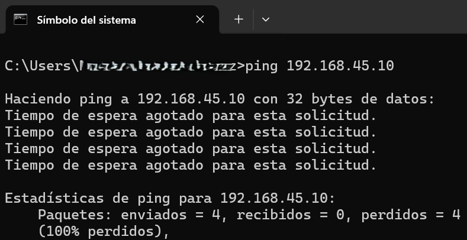
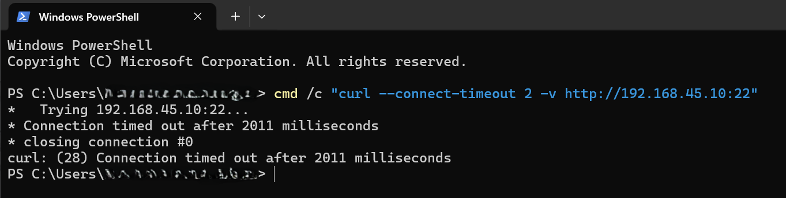
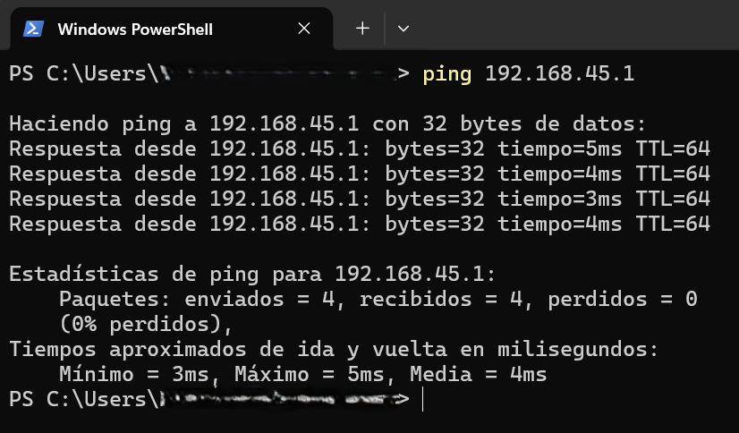
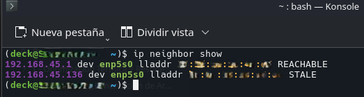

# Informe Técnico: Reingeniería de Red Local, Fortificación de Perímetro y Despliegue de Arquitectura Zero Trust

## 📝 1. Introducción y Objetivos del Proyecto

Este proyecto documenta el proceso de auditoría de red, fortificación perimetral del hogar y segmentación lógica basada en host en un entorno doméstico real, con el objetivo de mitigar el riesgo de movimiento lateral confinando dispositivos IoT en zonas aisladas, implementar una arquitectura Zero Trust a nivel de kernel y optimizar la infraestructura inalámbrica de malla suprimiendo el Doble NAT.

## 🛠 2. Ficha Técnica del Hardware (Inventario de Red) y Estado Inicial

La infraestructura analizada consta de una pasarela perimetral Sagemcom F@st 5657, un sistema mesh TP-Link Deco M4R (3 unidades), un host crítico (Steam Machine con Arch Linux) y una estación de auditoría (portátil MSI con Windows 11). 

De fábrica, el router operaba en el rango `192.168.1.0/24` con UPnP y WPS activos, mientras que la Steam Machine mantenía sus políticas de filtrado local en un estado permisivo (`ACCEPT`).

## 📈 3. Metodología de Pruebas y Herramientas Utilizadas

Para verificar el aislamiento sin interferencias, se emplearon cuatro métodos de diagnóstico: tests de eco ICMP en Capa de Red, consultas síncronas mediante `curl` para auditar sockets TCP, inspección de la tabla ARP (`ip neighbor`) y manipulación del motor Netfilter (`iptables`) con seguimiento de estado (`conntrack`).

## 🔧 4. Diario de Intervención Técnica (Implementación y Despliegue)

La intervención se estructuró bajo estrictos protocolos de continuidad y aseguramiento:

* **Plan de Retorno:** Se respaldó la configuración binaria del Sagemcom (`backup_sagemcom_original.bin`) y se validaron los métodos de reinicio físico mediante el micro-contacto del router y las bases de los nodos Deco.
* **Hardening Perimetral:** Se deshabilitaron las radios Wi-Fi del Sagemcom, se migró el segmento local a `192.168.45.1/24`, se anularon UPnP y WPS, y se fijaron reservas DHCP para la Steam Machine (`192.168.45.10`) y el nodo principal (`192.168.45.20`).
* **Despliegue Mesh:** Los Deco se mutaron a Modo Punto de Acceso (AP) para eliminar el Doble NAT, propagando la SSID segura `Red_Central_Segura` y habilitando una Red de Invitados (`Casa_Invitados_IoT`) con la opción *"Permitir acceso local"* estrictamente desactivada.
* **Fortificación del Endpoint (Arch Linux):** Se accedió a la `Konsole` de la Steam Machine para configurar el usuario root, vaciar reglas previas de `iptables` y aplicar una política restrictiva que bloquea el tráfico de entrada (`DROP`) salvo conexiones ya establecidas (`ESTABLISHED,RELATED`) y tráfico de bucle local (`lo`).

```bash
passwd
sudo iptables -F
sudo iptables -P INPUT DROP
sudo iptables -P OUTPUT ACCEPT
sudo iptables -A INPUT -m conntrack --ctstate RELATED,ESTABLISHED -j ACCEPT
sudo iptables -A INPUT -i lo -j ACCEPT
```

## 📊 5. Resultados Comparativos (Protocolo de Verificación y Auditoría)

Sometido a una auditoría de caja negra desde un equipo en la subred de invitados (`192.168.45.124`), el sistema respondió de la siguiente forma:

| ID Test | Objetivo de la Prueba | Comando de Auditoría Ejecutado | Resultado Métrico Obtenido | Veredicto Técnico |
| :--- | :--- | :--- | :--- | :--- |
| **Test 1** | Validación del bloqueo ICMP | `ping 192.168.45.10` | 100% de pérdida de paquetes | **ÉXITO (Host Opaco)** |
| **Test 2** | Escaneo síncrono del socket SSH | `cmd /c "curl --connect-timeout 2 -v http://192.168.45.10:22"` | Curl: (28) Connection timed out after 2001 ms | **ÉXITO (Modo Sigilo)** |
| **Test 3** | Comprobación de Línea Base WAN | `ping 192.168.45.1` | Respuesta desde 192.168.45.1: tiempo=4ms | **ÉXITO (Enrutamiento Activo)** |
| **Test 4** | Inspección de vecindario ARP | `ip neighbor show` | 192.168.45.124 dev eth0 lladdr [...] STALE | **ÉXITO (Canal Mitigado)** |

### 5.1. Evidencias Fotográficas de la Auditoría
* **Test 1:**

  
* **Test 2:**

  
* **Test 3:**
 
  
* **Test 4:**

  

## 💡 6. Conclusiones del Proyecto

La reingeniería implementada logró aislar los dispositivos de uso compartido en una red de invitados, eliminó la exposición de puertos del host crítico mediante una política de kernel restrictiva y suprimió la latencia del Doble NAT al configurar la malla en modo AP. Este caso demuestra la eficacia de combinar la segmentación de red con el endurecimiento de endpoints bajo el paradigma de Confianza Cero.

[↩️ Volver al Caso de Estudio](./README.md) | [🏠 Volver al Portafolio Principal](../../README.md)
